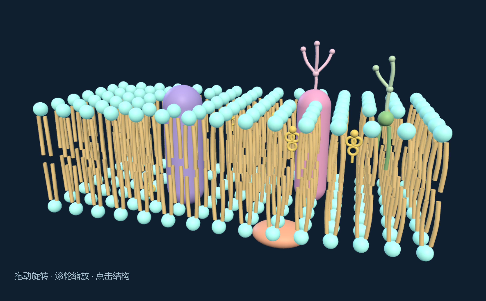

# BioLens · 生物，看得见

**中文** | [English](README.en.md)

交互式细胞生物学学习网站。

线上版本已支持中英双语：首页、课程地图、被动运输、细胞膜、细胞分裂、DNA 复制、线粒体与 ATP 合成、实验结构查看器，都可以用页头的「中文 / English」切换；加 `?lang=en` 可直接分享英文链接，站内跳转延续语言选择，切换语言不会重置模拟进度。第三方结构查看器 Mol* 自带的界面工具栏仍为英文。新版字体、导航指示条、单元切换与跨页转场已上线，并适配窄屏和减少动态效果偏好。

**一个可以亲手探索细胞生命活动的学习网站。** 从细胞结构出发，预测分子如何穿过膜，观察 DNA 如何复制、染色体如何分配，再把这些现象连回同一座细胞。

[打开 BioLens 在线体验](https://biolens-rouge.vercel.app/?lang=zh) · [从被动运输开始](https://biolens-rouge.vercel.app/passive.html?lang=zh) · [观察细胞分裂](https://biolens-rouge.vercel.app/mitosis.html?lang=zh)

以下配图保留中文模型标注；网站界面可切换语言。



## 从一个问题开始

**动态平衡时，分子是不是不动了？** 在被动运输单元中，你先留下预测，再看氧气分子在膜两侧持续运动和双向穿过；接着比较葡萄糖在有无可用载体时的表现，最后回看最初的判断。

这个学习过程按“预测 → 操作 → 观察 → 解释”组织。你可以暂停、单步推进、切换条件，再用自己的话说明看到的规律。

## 现在可以体验什么

| 学习路径 | 可以做的事 |
| --- | --- |
| 细胞世界与细胞膜 | 旋转、选择结构，观察细胞器和磷脂双分子层 |
| 被动运输 | 比较浓度和载体条件，观察双向跨膜与动态平衡 |
| DNA 复制与结构 | 探索解旋、碱基配对和相关结构 |
| 细胞分裂 | 沿时间轴追踪染色体进入两个子细胞 |
| 线粒体与 ATP 合成 | 把结构、质子梯度与能量转化联系起来 |

<p> </p>

## 本地运行

需要 Node.js 22 或更新版本，以及近期版本的 Edge 或 Chrome。在仓库根目录执行：

```text
node tools/preview.cjs 4188
```

然后打开 `http://127.0.0.1:4188/`。网页源码与本地资源位于 `dist/`，无需安装 npm 包或配置 API 密钥。请通过本地地址访问，不要直接双击 HTML；三维结构页面需要浏览器支持 WebGL。

## 作品范围与开发方式

BioLens 是高中/AP 生物的教学简化模型。粒子数量、运动速度和结构比例用于帮助理解概念，不是实际生理测量；目前也没有正式学习成效实验。

它支持 AP Biology 部分主题的学习，不是完整 AP 备考课程，也未经 College Board 官方认可。参见[课程对照草稿](AP_MAPPING.md)和[中英术语表](TERMINOLOGY_ZH_EN.md)。转录、翻译、渗透、主动运输与细胞周期专题等规划内容尚无独立课程，不计入已覆盖内容。双语词条的来源、术语取舍与待人工复核项见[翻译校对记录](TRANSLATION_REVIEW.md)。

作品由参赛者确定学习问题、课程路线、科学边界与验收方式，并在 OpenAI Codex、DeepSeek Harness 和豆包协作下完成开发、视觉改版与返工。网站运行时不调用大模型，不要求学生登录，也不采集学生学习档案。

Three.js、Mol* 及其许可证随 `dist/vendor/` 提供；开发用文案提取器 Acorn 的许可证位于 `tools/acorn-LICENSE.txt`。项目自有代码未另行授予开源许可证，第三方组件仍遵守各自许可。

如果你试过 BioLens，欢迎告诉我：哪一步帮助你理解了现象，哪一步仍然让你困惑？
