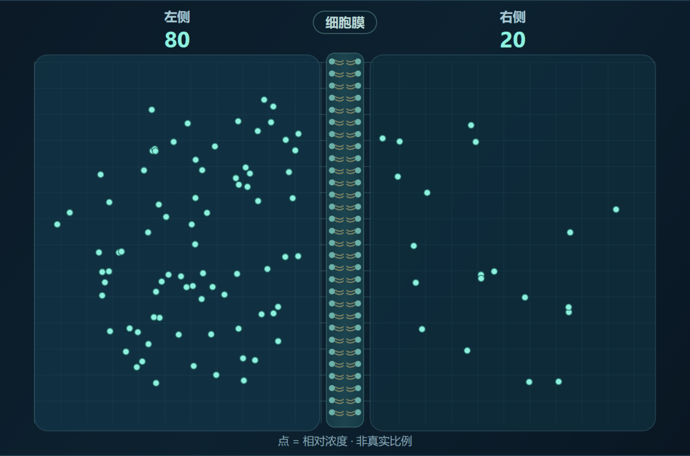
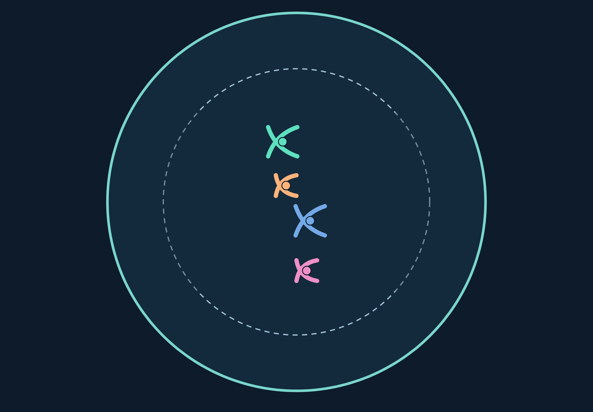

# BioLens · 生物，看得见

[中文](#中文) · [English](#english)

交互式细胞生物学学习网站 / An interactive site for exploring cell biology.

本工作副本的全部页面已中英双语：首页、课程地图、被动运输、细胞膜、细胞分裂、DNA 复制、线粒体与 ATP 合成、实验结构查看器，都可以用页头的「中文 / English」切换；加 `?lang=en` 可直接分享英文链接，站内跳转延续语言选择，切换语言不会重置模拟进度。第三方结构查看器 Mol* 自带的界面工具栏仍为英文。线上版本尚未更新，仍是中文。
In this working copy every page is bilingual: learning home, learning map, passive transport, membrane, cell division, DNA replication, mitochondria and ATP synthesis, and the structure viewer all switch between 中文 and English from the header. Add `?lang=en` for a shareable English link; in-page links keep the chosen language, and switching language does not reset simulation state. The bundled Mol* structure viewer keeps its own English interface. The deployed version is still Chinese-only and has not been updated.

## 中文

**一个可以亲手探索细胞生命活动的学习网站。** 从细胞结构出发，预测分子如何穿过膜，观察 DNA 如何复制、染色体如何分配，再把这些现象连回同一座细胞。

[打开 BioLens 在线体验](https://biolens-rouge.vercel.app/) · [从被动运输开始](https://biolens-rouge.vercel.app/passive.html) · [观察细胞分裂](https://biolens-rouge.vercel.app/mitosis.html)

以下配图保留中文模型标注；网站界面可切换语言。


## 从一个问题开始

**动态平衡时，分子是不是不动了？** 在被动运输单元中，你先留下预测，再看氧气分子在膜两侧持续运动和双向穿过；接着比较葡萄糖在有无可用载体时的表现，最后回看最初的判断。

这个学习过程按“预测 → 操作 → 观察 → 解释”组织。你可以暂停、单步推进、切换条件，再用自己的话说明看到的规律。

## 现在可以体验什么

| 学习路径 | 可以做的事 |
| --- | --- |
| 细胞世界与细胞膜 | 旋转、选择结构，观察细胞器和磷脂双分子层 |
| 被动运输 | 比较浓度和载体条件，观察双向跨膜与动态平衡 |
| DNA 复制与结构 | 探索解旋、碱基配对和相关结构 |
| 细胞分裂 | 沿时间轴追踪染色体进入两个子细胞 |
| 线粒体与 ATP 合成 | 把结构、质子梯度与能量转化联系起来 |

<p> </p>

## 本地运行

需要 Node.js 22 或更新版本，以及近期版本的 Edge 或 Chrome。在仓库根目录执行：

```text
node tools/preview.cjs 4188
```

然后打开 `http://127.0.0.1:4188/`。网页源码与本地资源位于 `dist/`，无需安装 npm 包或配置 API 密钥。请通过本地地址访问，不要直接双击 HTML；三维结构页面需要浏览器支持 WebGL。

## 作品范围与开发方式

BioLens 是高中/AP 生物的教学简化模型。粒子数量、运动速度和结构比例用于帮助理解概念，不是实际生理测量；目前也没有正式学习成效实验。

它支持 AP Biology 部分主题的学习，不是完整 AP 备考课程，也未经 College Board 官方认可。参见[课程对照草稿](AP_MAPPING.md)和[中英术语表](TERMINOLOGY_ZH_EN.md)。转录、翻译、渗透、主动运输与细胞周期专题等规划内容尚无独立课程，不计入已覆盖内容。双语词条的来源、术语取舍与待人工复核项见[翻译校对记录](TRANSLATION_REVIEW.md)。

作品由参赛者确定学习问题、课程路线、科学边界与验收方式，并在 OpenAI Codex、DeepSeek Harness 和豆包协作下完成开发、视觉改版与返工。网站运行时不调用大模型，不要求学生登录，也不采集学生学习档案。

Three.js、Mol* 及其许可证随 `dist/vendor/` 提供；开发用文案提取器 Acorn 的许可证位于 `tools/acorn-LICENSE.txt`。项目自有代码未另行授予开源许可证，第三方组件仍遵守各自许可。

如果你试过 BioLens，欢迎告诉我：哪一步帮助你理解了现象，哪一步仍然让你困惑？

## English

**Explore the processes of cellular life through interactive models.** Start with cell structures, predict how molecules cross a membrane, observe DNA replication and chromosome separation, and connect these processes within the same cell.

[Explore BioLens](https://biolens-rouge.vercel.app/) · [Start with passive transport](https://biolens-rouge.vercel.app/passive.html) · [Explore cell division](https://biolens-rouge.vercel.app/mitosis.html)

### Start with a question

**Do molecules stop moving at dynamic equilibrium?** In the passive transport unit, make a prediction, then watch oxygen molecules move on both sides of the membrane and cross in both directions. Compare glucose transport with and without an available carrier, then revisit your prediction.

The learning sequence is **predict → interact → observe → explain**. Pause, advance one step, change conditions, and describe the pattern in your own words.

### What you can explore

| Learning path | What you can do |
| --- | --- |
| Cells and membranes | Rotate models and select structures to explore organelles and the phospholipid bilayer |
| Passive transport | Compare concentration and carrier conditions; observe movement in both directions and dynamic equilibrium |
| DNA replication and structure | Explore unwinding, base pairing, and related structures |
| Cell division | Follow a timeline as chromosomes are distributed to two daughter cells |
| Mitochondria and ATP synthesis | Connect structure, proton gradients, and energy conversion |

The images in the Chinese section show the membrane model, a passive transport model with an initial 80:20 particle distribution, and the chromosome model used for cell division. They depict teaching models; the embedded labels in the membrane and passive-transport images are Chinese.

### Run locally

Use Node.js 22 or later and a recent version of Edge or Chrome. From the repository root, run:

```text
node tools/preview.cjs 4188
```

Open `http://127.0.0.1:4188/`. Source files and local assets are in `dist/`. No npm installation or API key is required. Use the local server rather than opening HTML files directly. The 3D structure pages require WebGL support.

### Scope and development

BioLens uses simplified models for high-school biology and selected AP Biology topics. Particle counts, motion speeds, and structural proportions illustrate concepts; they are not biological measurements. Learning outcomes have not been evaluated in a formal study.

BioLens is not a complete AP exam preparation course and is not endorsed by College Board. See the [curriculum mapping draft](AP_MAPPING.md) and [Chinese–English terminology guide](TERMINOLOGY_ZH_EN.md). Planned topics such as transcription, translation, osmosis, active transport, and a dedicated cell-cycle unit do not yet have standalone lessons and are not counted as covered. The [translation review](TRANSLATION_REVIEW.md) records where the English wording comes from, which terminology was chosen, and which entries still need a human pass.

The entrant defined the learning questions, course routes, scientific boundaries, and acceptance criteria, and collaborated with OpenAI Codex, DeepSeek Harness, and Doubao on development, visual updates, and revisions. The website does not call language models at runtime, require student accounts, or collect student learning profiles.

Three.js, Mol*, and their licenses are included in `dist/vendor/`. The development-only Acorn parser has its license in `tools/acorn-LICENSE.txt`. No separate open-source license has been granted for the project's own code. Third-party components remain subject to their respective licenses.

If you try BioLens, please share which step helped you understand a process and which step still felt unclear.
